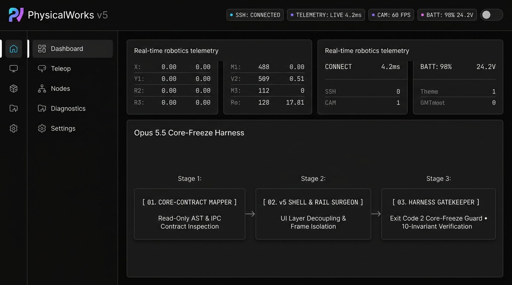
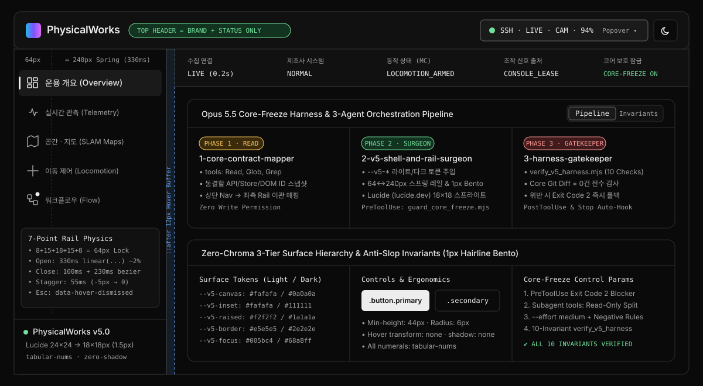

# PhysicalWorks v5 Design System & Opus 5.5 Harness (`physicalworks-design-harness`)

**Vercel Geist × PhysicalWorks v5 Zero-Chroma Console Theme**, **Left Hover-Reveal Rail (`64px ↔ 240px` Damped Spring)**, **Lucide SVG Icon System (`https://lucide.dev/icons/`)**, and **Core-Freeze Multi-Agent Harness Engineering** for Claude Code (Opus 5.5), Codex, and Antigravity.





---

## 1. Absolute Rule: 100% Core-Freeze (기능·코어 로직 변경 절대 금지)

이 하네스는 **오직 UI 디자인 시스템, 상단 Status 전용 헤더, 좌측 Hover 확장 내비게이션 레일, Lucide SVG 아이콘만 이식**하도록 설계되었습니다.
- **절대 금지**: 기존 프로젝트의 비즈니스 로직, 백엔드/API, 상태 관리(Store), 라우터 정의, 기능 추가/삭제, DOM `id`/`data-*` 바인딩 변경을 **물리적으로 차단**합니다.
- **4중 코어 보호 인자**:
  1. **`PreToolUse` Exit Code `2` 하드 블로커 ([`guard_core_freeze.mjs`](.agents/skills/x2-v5-console-harness/scripts/guard_core_freeze.mjs))**: 백엔드/API/스토어/모델 파일 수정 시도를 툴 실행 직전에 차단합니다.
  2. **3-Agent 권한 분리 오케스트레이션 ([`.claude/agents/`](.claude/agents/))**:
     - `1-core-contract-mapper.md` (`tools: Read, Glob, Grep` — 읽기 전용 코어 동결 목록 & 상단→좌측 Nav 매핑)
     - `2-v5-shell-and-rail-surgeon.md` (CSS 토큰·셸·좌측 레일·Lucide 스프라이트만 집도)
     - `3-harness-gatekeeper.md` (`verify_v5_harness.mjs` + `git diff` 코어 무결성 감사)
  3. **`PostToolUse` / `Stop` 디자인 불변성 검증기 ([`verify_v5_harness.mjs`](.agents/skills/x2-v5-console-harness/scripts/verify_v5_harness.mjs))**: 상단 헤더에 내비게이션 링크가 남아있거나 좌측 레일 스프링 수식/Lucide 규격이 누락되면 즉시 실패를 반환합니다.
  4. **모델 실행 인자 가이드 ([`META_PROMPT.md`](META_PROMPT.md))**: `temperature` 단독 제어의 한계를 보완하는 `--effort medium` + Negative Constraint 프롬프트 설계를 제공합니다.

---

## 2. Repository Structure

```text
physicalworks-design-harness/
├── DESIGN.md                                      # 규범적 디자인 시스템 명세서 (Geist × PhysicalWorks v5 + Left Hover Rail)
├── META_PROMPT.md                                 # "딸깍" 원클릭 구축 & 코어 무결성 이식 메타프롬프트
├── QA_PROMPT.md                                   # Opus 5.5 전용 하네스 구성도 & 디자인 완성도 100점 루브릭 QA 프롬프트
├── CLAUDE.md                                      # Claude Code (Opus 5.5) 엔트리포인트 지침서
├── AGENTS.md                                      # Codex / Antigravity / Cursor 멀티 에이전트 지침서
├── assets/
│   ├── physicalworks-v5-harness-hero.jpg          # UI & 3-Stage Opus 5.5 Core-Freeze Harness 쇼케이스 이미지
│   └── harness-architecture.svg                   # 7-Point Rail Physics & Bento 토큰 아키텍처 다이어그램
├── .claude/
│   ├── settings.json                              # PreToolUse(guard_core_freeze) + PostToolUse/Stop(verify_v5_harness)
│   └── agents/                                    # Opus 5.5 3-Agent Orchestration 서브에이전트 정의
│       ├── 1-core-contract-mapper.md              # Phase 1: Read-Only 코어 동결 & 상단->좌측 Nav 매퍼
│       ├── 2-v5-shell-and-rail-surgeon.md         # Phase 2: UI/CSS & 좌측 64<->240px 스프링 집도의
│       └── 3-harness-gatekeeper.md                # Phase 3: 코어 diff 0건 & 디자인 불변성 감사관
├── .codex/hooks.json                              # Codex 자동 검증 훅
├── .gemini/settings.json                          # Gemini / Antigravity 자동 검증 훅
├── .impeccable/config.json                        # Impeccable Anti-Slop 설정
├── .agents/skills/
│   ├── x2-v5-console-harness/                     # 핵심 파이프라인 스킬 + verify_v5_harness.mjs + guard_core_freeze.mjs
│   ├── impeccable-anti-slop/                      # Anti-Slop & WCAG 2.2 AA 검증 스킬
│   ├── apple-design-system/                       # 44px 터치 타깃, 포커스 트랩, 4pt 그리드 스킬
│   └── ui-ux-component-architecture/              # 2D/3D 캔버스, 노드 플로우, 고주파 폴링 안정성 스킬
└── reference/                                     # 순수 디자인 레퍼런스 (CSS / HTML Shell / Left Rail JS)
    ├── physicalworks_v5.css                       # --v5-* 토큰, 1px Bento, 64px<->240px 감쇠 스프링 원문
    ├── console.css                                # 기본 레이아웃 골격
    ├── console.html                               # 3-Tier Shell + 인라인 Lucide SVG 스프라이트 레퍼런스
    └── nav-hover-contract.js                      # Escape 즉시 닫기(data-hover-dismissed), 포커스 트랩, 200% 줌 동기화
```

---

## 3. 원클릭("딸깍") 이식 & QA 사용법

- **타 플랫폼 원클릭 구축 및 UI 이식**: **[`META_PROMPT.md`](META_PROMPT.md)** 프롬프트 복사 → Opus 5.5에 붙여넣기
- **하네스 아키텍처 & 디자인 완성도 100점 만점 QA 감사**: **[`QA_PROMPT.md`](QA_PROMPT.md)** 프롬프트 복사 → Opus 5.5에 붙여넣기

```bash
git clone --depth 1 https://github.com/dosigner/physicalworks-design-harness.git /tmp/pw-v5-harness && \
cp /tmp/pw-v5-harness/DESIGN.md /tmp/pw-v5-harness/META_PROMPT.md /tmp/pw-v5-harness/QA_PROMPT.md /tmp/pw-v5-harness/CLAUDE.md /tmp/pw-v5-harness/AGENTS.md ./ && \
cp -R /tmp/pw-v5-harness/.agents /tmp/pw-v5-harness/.claude /tmp/pw-v5-harness/.codex /tmp/pw-v5-harness/.gemini /tmp/pw-v5-harness/.impeccable ./ && \
rm -rf /tmp/pw-v5-harness
```
